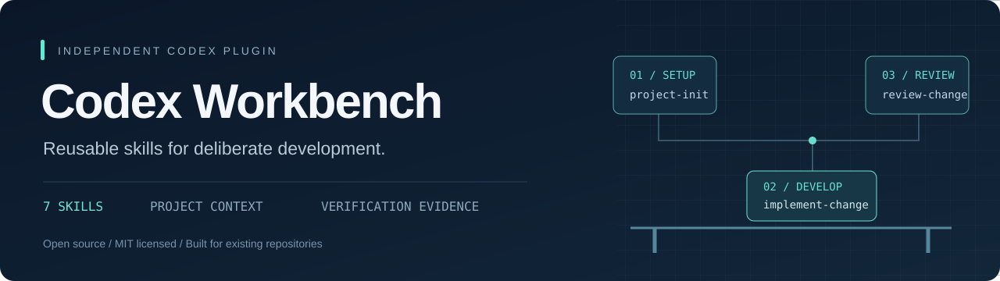
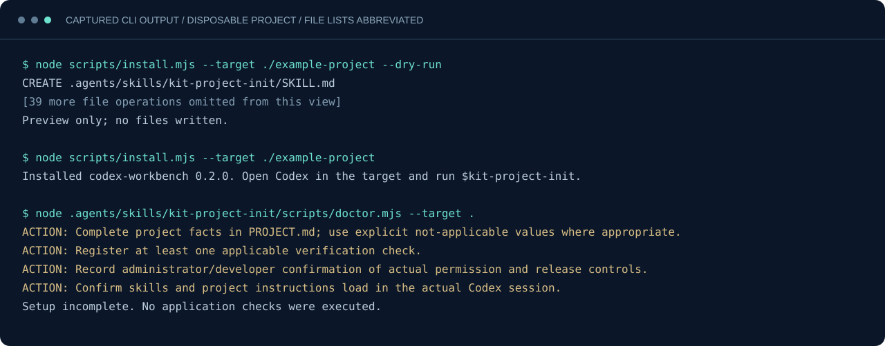
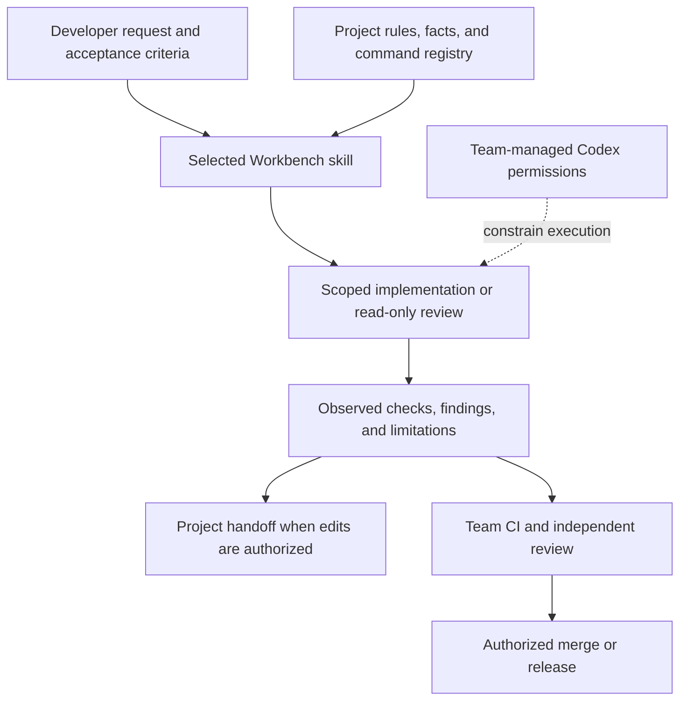

# Codex Workbench

**Give Codex a repeatable way to work in your repository.**

An independent Codex plugin with seven skills for project setup, implementation, testing, review, documentation, and handoffs. Bring project context and verification evidence into the same workflow while preserving existing repository rules.

[](https://github.com/snerdx/codex-workbench/actions/workflows/kit-checks.yml)
[](LICENSE)


[Install](#quick-start) / [See the demo](#see-the-installer-in-action) / [Explore the skills](#seven-skills-one-development-workflow) / [Design decisions](docs/DESIGN-DECISIONS.md)

> **Distribution status:** project-local installation is covered by automated tests. Plugin packaging is included; live plugin-host installation and live Codex skill discovery still require pilot verification. Independent project, not affiliated with or endorsed by OpenAI.

## Why this exists

A developer adopting Codex needs more than a prompt: the repository's constraints, commands that have been inspected, boundaries for editing, and a handoff that distinguishes tested work from assumptions. Those details are easy to lose between tasks or developers.

Workbench packages that process as reusable skills. It gives an existing project a shared starting point, then keeps application facts and verification records under the team's control.

## Quick start

Requires **Node.js 20+**, Git, and **Codex CLI or the Codex IDE extension**. The toolkit uses the Node standard library; no package installation is needed.

### 1. Preview and install

Clone Workbench alongside your application. Replace the example target with your existing project directory.

```sh
git clone https://github.com/snerdx/codex-workbench.git
cd codex-workbench
node scripts/install.mjs --target "/absolute/path/to/your-project" --dry-run
node scripts/install.mjs --target "/absolute/path/to/your-project"
```

On Windows, use a quoted path such as `"C:/Projects/my-app"`. Review the preview first. Existing root instructions are preserved; conflicting skill files stop installation. [Update and recovery behavior](docs/INSTALLATION.md).

### 2. Initialize your project in Codex

Open **your application repository**, confirm the `kit-` skills appear in `/skills` or the `$` selector, and send:

```text
$kit-project-init
Inspect this repository and configure its project facts and verification
commands. Preserve existing conventions and explain missing decisions.
```

Codex uses the setup workflow to inspect the project and complete its context. If root AGENTS.md already exists, merge the suggested routing without replacing the team's rules. Installation alone does not run application commands or change permissions.

### 3. Implement a bounded task

```text
$kit-implement-change
Goal: Reject expired password-reset links.
Acceptance criteria: Expired links fail without changing the password;
valid links still work. Add regression coverage and report actual results.
Constraints: Preserve the current public API.
```

Use your own application's requirements. For setup gaps, run the readiness helper **from your application directory**:

```sh
node .agents/skills/kit-project-init/scripts/doctor.mjs --target .
```

It reports unfinished configuration. It does not run your application tests or independently verify permission controls.

## See the installer in action



Actual helper output captured in a disposable empty project. File lists are abbreviated and temporary paths are shortened for presentation. The readiness check intentionally reports incomplete setup. No live Codex conversation or application-test success is staged. [Full captured output](assets/demo-output.json) / [Reproduce the capture](docs/DEMO.md).

## Seven skills, one development workflow

| Skill | Use it to | Result |
|---|---|---|
| [`$kit-project-init`](skills/kit-project-init/SKILL.md) | Onboard an existing or new repository | Project facts, inspected commands, and explicit setup gaps |
| [`$kit-implement-change`](skills/kit-implement-change/SKILL.md) | Implement a scoped feature or bug fix | Focused edits, relevant checks, and reported evidence |
| [`$kit-review-change`](skills/kit-review-change/SKILL.md) | Review specified code or a diff | Read-only findings with triggers, evidence, and confidence |
| [`$kit-test-change`](skills/kit-test-change/SKILL.md) | Test an agreed behavior contract | Behavior checks, observed results, and coverage gaps |
| [`$kit-refactor`](skills/kit-refactor/SKILL.md) | Improve code structure | Behavior-preserving changes with verification limits |
| [`$kit-document-change`](skills/kit-document-change/SKILL.md) | Explain verified code and workflows | Documentation grounded in source and actual commands |
| [`$kit-handoff`](skills/kit-handoff/SKILL.md) | Transfer or resume work | Current state, check results, blockers, and next action |

These are selectable workflows, not seven independent reviewers. Applying a review skill in the implementing session remains self-review.

## How it fits together



Skills guide work; the organization enforces access and release policy. Project facts live in `docs/codex-kit/`, skills in `.agents/skills/`, and the application retains its own root instructions. [Team security and rollout](docs/TEAM-GUIDE.md).

## Engineering choices worth inspecting

| Decision | Why it matters | Evidence |
|---|---|---|
| Preview before writes; preserve existing files | Teams can adopt Workbench without replacing repository rules | [Installer and regression tests](tests/toolkit.test.mjs) |
| Check update ownership with SHA-256 receipts | Customized skills require a manual merge instead of silent replacement | [Update implementation](scripts/install.mjs) |
| Keep reviews read-only | A review request does not mutate source or session notes | [Review workflow](skills/kit-review-change/SKILL.md) |
| Separate setup attestations from enforcement | Readiness records do not masquerade as actual permission controls | [Readiness helper](skills/kit-project-init/scripts/doctor.mjs) |
| Carry MIT notices with installed resources | Toolkit notices travel with skills and project templates | [License and preservation tests](tests/toolkit.test.mjs) |

[Read the design rationale and tradeoffs](docs/DESIGN-DECISIONS.md).

## Quality and current limits

- **14 regression tests** cover preservation, update conflicts, destination links, readiness, license notices, and validator failure cases.
- **GitHub Actions** runs package validation and tests on Linux and Windows.
- **11 predicate cases** demonstrate a behavior-preserving refactor, including truthy non-boolean inputs.
- Package checks validate listed files, supported local link syntax, skill metadata shape, and JavaScript syntax. They do not prove instruction compliance or application safety.

Live plugin installation, live CLI/IDE discovery, and model behavior under the [evaluation scenarios](evals/scenarios.md) remain pilot work. Full skill-creator YAML validation is also outstanding. [Verification record](docs/RELEASE-0.2.0.md) / [CI runs](https://github.com/snerdx/codex-workbench/actions).

To inspect the mechanics yourself, run from this repository:

```sh
node scripts/validate-kit.mjs
node --test tests/toolkit.test.mjs
```

## Project and contribution

Created by **[Laurie Andreola](https://github.com/snerdx)**, with Codex-assisted development. This project explores how reusable skills, repository context, non-destructive installation, and verification evidence can support consistent AI-assisted development.

The next milestones are live plugin-host verification, observed skill discovery in supported clients, and behavioral evaluation in isolated projects. Measured team-adoption results will be reported when available.

For a bug or proposed improvement, [open an issue](https://github.com/snerdx/codex-workbench/issues) with the command or workflow, environment, expected result, and redacted evidence. Before proposing code changes, run the package checks and relevant regression tests. Do not include credentials or private project data.

[Installation and updates](docs/INSTALLATION.md) / [Design decisions](docs/DESIGN-DECISIONS.md) / [Maintaining the toolkit](docs/MAINTAINING.md) / [Changelog](CHANGELOG.md)

## License

[MIT](LICENSE), copyright 2026 Laurie Andreola. Retain the copyright and permission notice with copies or substantial portions of the toolkit. Using Workbench does not require open-sourcing your application. Existing application licenses are preserved.
